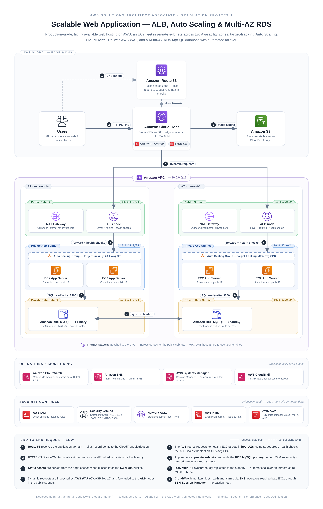

# Scalable Web Application on AWS — ALB, Auto Scaling & Multi-AZ RDS

> **AWS Solutions Architect – Associate (SAA-C03) · Graduation Project 1**
> A production-grade, highly available web application architecture built with EC2, Application Load Balancer, Auto Scaling, CloudFront, and Multi-AZ RDS — deployed entirely as Infrastructure as Code.



---

## 📌 Project Overview

This project delivers a **production-grade, scalable, and highly available** web application hosting architecture on AWS. The design follows the classic three-tier model — **edge, application, and data tiers** — deployed across **two Availability Zones** in the `us-east-1` region for fault tolerance.

The workload is a typical stateless web application (e.g., a content site, REST-backed web app, or e-commerce frontend) that must survive the loss of an entire Availability Zone with no manual intervention, absorb traffic spikes automatically, and serve a global audience with low latency.

### Design Goals

| Goal | Approach |
|------|----------|
| **High availability** | Multi-AZ deployment at every tier — ALB nodes, EC2 fleet, NAT Gateways, and RDS Multi-AZ |
| **Elastic scalability** | Auto Scaling with target-tracking policy (40% avg CPU) + ALB cross-zone load balancing |
| **Global performance** | CloudFront CDN caches static assets at 600+ edge locations |
| **Defense in depth** | Private subnets for compute & data, Security Groups, NACLs, WAF, Shield, IAM roles, KMS |
| **Operational excellence** | Session Manager (bastion-free access), CloudWatch dashboards & alarms, SNS alerts, CloudTrail audit |
| **Repeatability** | 100% Infrastructure as Code — a single CloudFormation template deploys the entire stack |

### Core AWS Services

| Service | Role in this architecture |
|---------|--------------------------|
| **Amazon VPC** | Isolated network — 6 subnets (public/app/data) across 2 AZs, route tables, IGW, NAT Gateways |
| **Amazon EC2** | Application servers (t3.medium) in **private subnets**, no public IPs |
| **Auto Scaling** | Target-tracking scaling on 40% average CPU; min 2 / desired 2 / max 6 instances |
| **Application Load Balancer** | Layer-7 entry point in public subnets; health checks; cross-zone load balancing |
| **Amazon CloudFront** | Global CDN; static-asset cache behavior pointing to S3; dynamic behavior via ALB |
| **AWS WAF** | Managed rule groups for OWASP Top 10 (SQLi, XSS) + rate-based brute-force protection |
| **Amazon RDS (MySQL)** | Multi-AZ deployment — synchronous standby with automatic failover (~60 s) |
| **Amazon S3** | Static assets bucket (CloudFront origin) with Block Public Access enabled |
| **Amazon Route 53** | Public hosted zone with an alias record to the CloudFront distribution |
| **AWS Systems Manager** | Session Manager for bastion-free, audited shell access to private EC2s |
| **Amazon CloudWatch + SNS** | Dashboards, CPU/ALB/RDS alarms, email notifications |
| **AWS KMS / ACM / IAM** | Encryption at rest, TLS certificates, least-privilege instance roles |

---

## 🏗️ Architecture Overview

The architecture is organized into four planes: the **global edge**, the **VPC network**, the **operations plane**, and the **security plane**. All compute and data resources live in private subnets — only the ALB nodes and NAT Gateways are exposed to the internet.

### 1 · Global Edge Layer

**Route 53** hosts the public DNS zone. An **alias A/AAAA record** points the application domain (e.g., `app.example.com`) to the **CloudFront** distribution. Alias records are free-of-charge queries that automatically track the CloudFront distribution's IP addresses, and Route 53 health checks can be attached for DNS-level failover scenarios.

**CloudFront** accelerates both content types with two cache behaviors:

- `/static/*` → **S3 origin** — immutable assets (CSS, JS, images, fonts) cached at edge locations with long TTLs. This offloads the majority of requests (typically 70–90% of a page's weight) from the origin entirely.
- `Default (*)` → **ALB origin** — dynamic HTML/API traffic is forwarded to the load balancer, with caching disabled but **TLS termination and connection reuse** still applied at the edge.

**AWS WAF** is attached to the CloudFront distribution with:
- `AWSManagedRulesCommonRuleSet` — OWASP Top 10 protections (SQLi, XSS, LFI/RFI)
- `AWSManagedRulesKnownBadInputsRuleSet` — log4j / SSRF / bad-bot signatures
- A **rate-based rule** (2,000 requests / 5 min / per client IP) to absorb brute-force and scraping floods

**AWS Shield Standard** is automatically included on CloudFront and ALB for common L3/L4 DDoS mitigation at no extra cost.

### 2 · Network Layer — VPC 10.0.0.0/16

The VPC is spread across **two Availability Zones** (`us-east-1a`, `us-east-1b`), with three subnet tiers per AZ:

| Subnet | AZ-A | AZ-B | Contains | Internet-routable? |
|--------|------|------|----------|--------------------|
| Public | `10.0.1.0/24` | `10.0.2.0/24` | ALB nodes, NAT Gateway | ✅ Yes (via IGW) |
| Private App | `10.0.11.0/24` | `10.0.12.0/24` | EC2 Auto Scaling fleet | ❌ No |
| Private Data | `10.0.21.0/24` | `10.0.22.0/24` | RDS Primary / Standby | ❌ No |

**Routing design:**

- **Public subnets** have a route `0.0.0.0/0 → Internet Gateway`. This is what makes the ALB nodes and NAT Gateways internet-facing.
- **Private app subnets** have a route `0.0.0.0/0 → NAT Gateway` (one per AZ). This lets EC2 instances fetch OS packages, pull container images, or call external APIs **without being reachable from the internet**. One NAT Gateway **per AZ** avoids cross-AZ data transfer charges and removes the NAT as a single point of failure.
- **Private data subnets** have **no default route at all** — the database tier cannot initiate outbound internet connections, which shrinks the data exfiltration blast radius.
- **VPC DNS hostnames and resolution** are enabled so instances can resolve the RDS endpoint and each other's names.

**Network ACLs** add a stateless, subnet-level filter layer on top of Security Groups (allow established traffic plus only the specific ports needed per tier), implementing genuine defense in depth.

### 3 · Compute Layer — EC2 + Auto Scaling + ALB

The **Auto Scaling group** launches `t3.medium` instances from a **Launch Template**:

- **Amazon Linux 2023** AMI with the user-data bootstrap script (`scripts/user-data.sh`) that installs and configures the web server, then waits on the ALB target group port.
- **Min 2 / Desired 2 / Max 6** — one instance is guaranteed in each AZ (via `AvailabilityZoneRebalance`), so a single AZ failure never takes the app offline.
- **Target-tracking scaling policy**: keep `CPUUtilization` at **40% average**. When aggregate CPU exceeds the target, the ASG adds capacity; when it falls below, instances are drained (via ALB connection draining / deregistration delay) and terminated. This is simpler and more stable than step scaling for web workloads.
- **Instance refresh** is enabled so configuration changes roll out gradually without downtime.

The **Application Load Balancer** is internet-facing, spanning both public subnets:

- **HTTP :80** redirects to **HTTPS :443** (TLS certificate provisioned by **ACM**).
- The **target group** health-checks `/health` every 15 s (healthy threshold 2, unhealthy 3). An instance that fails its check is pulled from rotation automatically.
- **Cross-zone load balancing** (enabled by default) distributes requests evenly across all healthy targets in both AZs.
- Deregistration delay (connection draining) of 30 s prevents in-flight requests from being dropped during scale-in or deployments.

All EC2 instances run with an **IAM instance role** that grants only: SSM Session Manager core permissions (for ops access), CloudWatch agent write access, and read-only access to the S3 assets bucket. No SSH keys are deployed and **port 22 is closed everywhere** — administrative access happens exclusively through **Systems Manager Session Manager**, which provides per-session audit logs in CloudWatch Logs / S3 without any bastion host.

### 4 · Data Layer — RDS MySQL Multi-AZ

A **db.t3.medium MySQL 8.0** instance runs with **Multi-AZ deployment** enabled:

- The **primary** lives in the AZ-A data subnet; a **synchronous standby** is maintained in the AZ-B data subnet.
- Every write is committed on **both** the primary and standby before acknowledgment — the standby is always transactionally consistent (RPO ≈ 0 for the supported failure modes).
- On infrastructure failure (primary instance, storage, or AZ outage), RDS automatically **fails over to the standby in ~60 seconds**. The **same CNAME endpoint is preserved**, so the application reconnects with no code change — standard MySQL client retry logic is sufficient.
- **Encryption at rest** uses a customer-managed **KMS key**; **TLS connections** are enforced; **automated backups** (35-day retention) with PITR (point-in-time recovery), and deletion protection, are enabled.
- **Only the app-tier Security Group** may reach port 3306 — not the ALB, not the public subnets, not the internet.

---

## 🔁 End-to-End Request Flow

The numbered steps below match the badges on the architecture diagram.

```
                    ┌──────────────────────── GLOBAL EDGE ────────────────────────┐
  ① DNS lookup  →   Route 53  ──alias──►  CloudFront (+ WAF + Shield)
                    └──────┬──────────────────────────────────┬──────────────────┘
                    ② HTTPS :443                        ③ static assets (cache miss)
                           ▼                                      ▼
                    [ dynamic requests ]                        Amazon S3
                           ▼
┌──────────────────────────── VPC 10.0.0.0/16 ────────────────────────────────────┐
│  ④ ──► ALB node (public subnet, AZ-A)      ALB node (public subnet, AZ-B)        │
│              │ ⑤ forward + health checks            │                            │
│              ▼                                      ▼                            │
│        ┌─ Private App Subnet 10.0.11.0/24 ┐  ┌─ Private App Subnet 10.0.12.0/24 ┐│
│        │  EC2 ── EC2   (ASG, 40% CPU)     │  │  EC2 ── EC2   (ASG, 40% CPU)    ││
│        └──────────────┬───────────────────┘  └──────────────┬──────────────────┘│
│               ⑥ SQL read/write :3306                 ⑥       │                  │
│                       ▼                                     ▼                  │
│        ┌─ Private Data 10.0.21.0/24 ─┐  ⑦ sync replication ┌─ Private Data ──┐  │
│        │  RDS MySQL — PRIMARY        │ ◄═════════════════► │  RDS — STANDBY  │  │
│        └─────────────────────────────┘   (auto failover)   └─────────────────┘  │
└──────────────────────────────────────────────────────────────────────────────────┘
```

1. **DNS resolution** — the client's browser resolves `app.example.com` through **Route 53**, which returns the CloudFront distribution's edge IP via an alias record.
2. **Edge termination** — the HTTPS request (TLS 1.3, certificate managed by **ACM**) lands at the nearest **CloudFront edge location**.
3. **Static assets** — requests for `/static/*` are served from the edge cache; on a cache miss, CloudFront fetches the object from the **S3 origin** bucket and caches it at the edge for subsequent users.
4. **Dynamic traffic** — all other paths pass **WAF inspection** at the edge (OWASP rules + rate limiting) before being forwarded over the CloudFront→ALB origin connection.
5. **Load balancing** — the **ALB** terminates the request, picks a **healthy target** in either AZ (cross-zone), and forwards it. Health checks continuously evict unhealthy instances from rotation; the **ASG** replaces them automatically.
6. **Application logic** — the EC2 app server processes the request and reads/writes the **RDS MySQL primary** on port 3306 (Security-Group-to-Security-Group rule, never a CIDR).
7. **Data durability** — every committed transaction is **synchronously replicated** to the standby RDS instance in the second AZ. If the primary or its AZ fails, RDS promotes the standby in about a minute, keeping the same endpoint.
8. **Observability loop** — CloudWatch collects ALB, EC2, and RDS metrics; threshold breaches raise alarms that fan out to an **SNS topic** (email); every API call in the account is captured by **CloudTrail**.

---

## 🔐 Security — Defense in Depth

Security is layered so that no single control is a single point of failure:

| Layer | Control | Detail |
|-------|---------|--------|
| **Edge** | AWS WAF | Managed OWASP Top 10 rule groups + rate-based rule (2,000 req/5 min/IP) |
| **Edge** | AWS Shield Standard | Automatic L3/L4 DDoS absorption (included with CloudFront/ALB) |
| **Edge** | ACM + TLS 1.2+ | Certificates auto-renewed; HTTP→HTTPS redirect |
| **Network** | Private subnets | Compute and data tiers have **no internet path** (NAT is outbound-only) |
| **Network** | Network ACLs | Stateless subnet filters restricting traffic to required ports |
| **Network** | Security Groups | Least privilege: `ALB-SG → App-SG :8080`, `App-SG → DB-SG :3306`; SG-referencing instead of CIDRs |
| **Compute** | IAM instance role | Only SSM, CloudWatch publish, S3 read — no wildcards |
| **Compute** | SSM Session Manager | No SSH keys, no bastion, port 22 closed; sessions logged |
| **Data** | KMS encryption | EBS volumes and RDS encrypted with customer-managed keys |
| **Data** | RDS hardening | No public access, deletion protection, 35-day PITR backups |
| **Data** | S3 hardening | Block Public Access, SSL-only bucket policy, versioning |

**Why SG-referencing matters:** the rule `App-SG → DB-SG :3306` means *any* instance that carries the App-SG may talk to *any* resource carrying the DB-SG on 3306 — regardless of its IP. When the ASG adds instances, the firewall rules automatically apply. No CIDR maintenance, no stale rules.

---

## ⚖️ High Availability & Scalability Analysis

### What fails, and what happens when it does

| Failure scenario | Impact | Recovery mechanism | Est. recovery |
|------------------|--------|--------------------|---------------|
| Single EC2 instance crash | ~50% capacity in one AZ | ALB health check evicts target; ASG launches replacement | ~1–2 min |
| Entire AZ outage | ALB nodes, EC2, NAT, RDS primary in that AZ | ALB + ASG keep serving from other AZ; RDS fails over to standby | ~60 s (DB), seconds (web tier) |
| RDS primary storage failure | Database writes unavailable | Automatic Multi-AZ failover, same endpoint | ~60 s |
| Traffic spike (10×) | Slow responses | Target-tracking scales 2 → 6 instances; CloudFront absorbs static load | 2–5 min |
| NAT Gateway failure (one AZ) | Outbound internet from that AZ's app subnet | Traffic shifts to the healthy AZ's NAT via its route table | seconds (re-route) |

### Availability math

With the fleet spread across two AZs and an auto-healing ASG, the *web tier* availability approaches the product of independent AZ availabilities. AWS targets **99.99%+ infrastructure availability across two AZs** for such designs. The database tier's availability is governed by Multi-AZ failover (~60 s per event). In practice, this architecture comfortably supports an **SLO of 99.9% (43.8 min downtime/month)**, with most of that budget consumed by deployments rather than failures.

### Why target tracking instead of step scaling?

Target tracking lets you state the *outcome you want* ("keep CPU at 40%") and lets the ASG compute the required capacity — including metric warm-up and instance warm-up handling. Step scaling requires manually authored thresholds and adjustments that need re-tuning as the workload changes. For a web tier with a well-understood CPU→latency relationship, target tracking is the lower-operational-overhead choice, and it scales in *and* out symmetrically.

---

## 💰 Cost Estimation (us-east-1, on-demand, monthly)

Estimated for the **baseline state** (2 × t3.medium, Multi-AZ RDS, 1 TB CloudFront egress):

| Service | Configuration | Monthly (USD) |
|---------|---------------|--------------|
| EC2 | 2 × t3.medium (2 vCPU / 4 GB) | ~$60 |
| ALB | 1 LCU-light internet-facing | ~$20 |
| NAT Gateway | 2 × (hourly + 50 GB processed) | ~$80 |
| RDS MySQL Multi-AZ | db.t3.medium + 100 GB gp3 + Multi-AZ double | ~$180 |
| CloudFront | 1 TB egress + 10M requests | ~$90 |
| S3 | 50 GB storage + requests | ~$5 |
| CloudWatch / SNS / SSM | Basic metrics, 1 alarm, sessions | ~$5 |
| **Total baseline** | | **≈ $440 / month** |

**Cost levers (what changes the bill):**
- **Savings Plans / RIs** on the EC2 + RDS baseline commitment → up to **–40%**
- **Graviton (t4g.medium)** instances → ~20% cheaper than t3 at better price-performance
- **RDS Single-AZ** for dev/stage (keep Multi-AZ in prod!) → –$90
- **One NAT Gateway** (accepting cross-AZ charges and a failure domain) → –$40
- **CloudFront savings bundle** → –30% on CDN costs

> ⚠️ **Important:** this stack is *not* free-tier friendly (NAT + Multi-AZ RDS dominate). Use the [AWS Pricing Calculator](https://calculator.aws/) for your workload, and **tear the stack down when done** (see Cleanup).

---

## 🏆 Well-Architected Alignment

| Pillar | How this architecture applies it |
|--------|----------------------------------|
| **Operational Excellence** | 100% IaC (CloudFormation) with drift-detectable, repeatable deploys; Session Manager audit trail; CloudWatch dashboards + SNS alarms on every tier |
| **Security** | Defense in depth across edge/network/compute/data; least-privilege IAM roles; encryption in transit (TLS everywhere) and at rest (KMS on EBS + RDS); no public compute |
| **Reliability** | Multi-AZ at every tier; ASG self-healing; RDS automatic failover; ALB health checks; deployment-safe instance refresh |
| **Performance Efficiency** | CloudFront edge caching offloads the origin; ALB cross-zone balancing; RDS connection reuse; right-sized burstable instances for variable web loads |
| **Cost Optimization** | Target-tracking scaling matches spend to demand; CloudFront reduces origin egress; S3 lifecycle-ready bucket design; Savings-Plan-ready steady state |
| **Sustainability** | Smallest viable instance footprint that auto-shrinks at night/weekends; edge caching reduces network transit energy; scale-to-2 floor avoids idle over-provisioning |

---

## 🚀 Deployment

### Prerequisites

- An AWS account with admin (or sufficiently delegated) permissions
- AWS CLI v2 configured (`aws configure`)
- A registered domain (only needed for the full Route 53 + ACM flow — the template works without one)
- Sufficient EC2 service quotas (running t3.medium instances) and RDS quota in `us-east-1`

### Option A — One-command deploy

```bash
aws cloudformation deploy \
  --template-file cloudformation/template.yaml \
  --stack-name scalable-web-app \
  --capabilities CAPABILITY_NAMED_IAM \
  --parameter-overrides \
      EnvironmentName=prod \
      KeyName=optional-but-see-notes \
      LatestAmiId=/aws/service/ami-amazon-linux-latest/al2023-ami-kernel-default-x86_64
```

The deploy takes **~15 minutes** (RDS Multi-AZ is the long pole). On completion:

```bash
aws cloudformation describe-stacks --stack-name scalable-web-app \
  --query "Stacks[0].Outputs" --output table
```

Outputs include the **ALB DNS name**, **CloudFront domain**, **S3 bucket**, and the **RDS endpoint** — you can test immediately by hitting the CloudFront domain over HTTPS.

### What the template creates

~35 resources, including: VPC + 6 subnets + routing, 2 NAT Gateways, internet-facing ALB + target group + HTTPS redirect, launch template + ASG with target tracking, RDS MySQL 8.0 Multi-AZ + subnet group + parameter group, S3 assets bucket, CloudFront distribution + WAF web ACL, IAM roles (EC2 instance profile), CloudWatch alarms + SNS topic, SSM association (Session Manager), Route 53 hosted zone (if a domain is provided).

### Testing the deployment

```bash
# 1. Hit the app through CloudFront (dynamic path)
curl -I https://<cloudfront-domain>/

# 2. Upload a test asset and fetch it from the edge
echo "hello" > test.css
aws s3 cp test.css s3://<assets-bucket>/static/test.css
curl -I https://<cloudfront-domain>/static/test.css     # x-cache: Miss from cloudfront
curl -I https://<cloudfront-domain>/static/test.css     # x-cache: Hit  from cloudfront

# 3. Verify bastion-free access to a private instance
INSTANCE_ID=$(aws ec2 describe-instances --filters \
  "Name=tag:aws:autoscaling:groupName,Values=<asg-name>" \
  --query "Reservations[].Instances[].InstanceId" --output text | head -1)
aws ssm start-session --target "$INSTANCE_ID"

# 4. Watch the ASG scale (generate load from one instance)
sudo yum install -y stress && stress --cpu 2 --timeout 300   # CPU > 40% → scale-out
```

### Cleanup (avoid surprise bills!)

```bash
aws s3 rm s3://<assets-bucket> --recursive           # empty the bucket first
aws cloudformation delete-stack --stack-name scalable-web-app
```

---

## 📁 Repository Structure

```
.
├── README.md                                  ← you are here
├── architecture-diagram/
│   └── scalable-web-app-architecture.png      ← high-res architecture diagram
├── cloudformation/
│   ├── template.yaml                          ← full-stack IaC (VPC→ALB→ASG→RDS→CDN→WAF)
│   └── parameters.json                        ← example parameter file
├── docs/
│   ├── architecture-deep-dive.md              ← design decisions & trade-offs (ADR style)
│   ├── security.md                            ← security controls detail
│   ├── cost-estimation.md                     ← cost breakdown & optimization levers
│   └── deployment-guide.md                    ← step-by-step deployment walkthrough
├── scripts/
│   └── user-data.sh                           ← EC2 bootstrap (web server + health endpoint)
└── assets/icons/                              ← AWS official service icons (diagram source)
```

---

## 🎓 Learning Outcomes (SAA-C03 alignment)

This project demonstrates the following exam blueprint skills:

- ✅ **Design secure VPCs** — multi-AZ public/private subnetting, route tables, NAT Gateway placement, NACL vs Security Group layering
- ✅ **Design high-availability architectures** — every tier redundant across AZs, automated failure detection and recovery
- ✅ **ALB listener rules and target-group health checks** — HTTPS redirect, health-check tuning, deregistration delay
- ✅ **Auto Scaling policies** — target tracking vs step scaling trade-offs, warm-up, instance refresh
- ✅ **Edge security** — WAF managed rules, rate-based rules, Shield Standard, ACM certificate lifecycle
- ✅ **Database resilience** — RDS Multi-AZ failover semantics, RPO/RTO reasoning, encryption at rest
- ✅ **Bastion-free operations** — SSM Session Manager with IAM instance roles and full audit trail

---

## 📚 References

- [AWS Well-Architected Framework](https://docs.aws.amazon.com/wellarchitected/latest/framework/)
- [AWS Prescriptive Guidance: Multi-AZ web application](https://docs.aws.amazon.com/prescriptive-guidance/latest/definitions/multi-az.html)
- [Amazon RDS Multi-AZ deployments](https://docs.aws.amazon.com/AmazonRDS/latest/UserGuide/Concepts.MultiAZ.html)
- [Target tracking scaling policies](https://docs.aws.amazon.com/autoscaling/ec2/userguide/as-scaling-target-tracking.html)
- [AWS WAF managed rule groups](https://docs.aws.amazon.com/waf/latest/developerguide/aws-managed-rule-groups-list.html)
- [Systems Manager Session Manager](https://docs.aws.amazon.com/systems-manager/latest/userguide/session-manager.html)

---

*Built as Graduation Project 1 for the AWS Solutions Architect – Associate (SAA-C03) program. All infrastructure is defined in CloudFormation and reproducible in any AWS account.*

